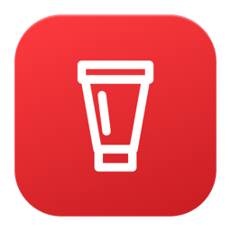
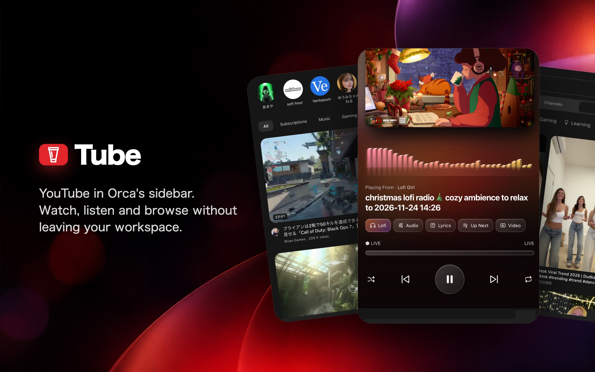
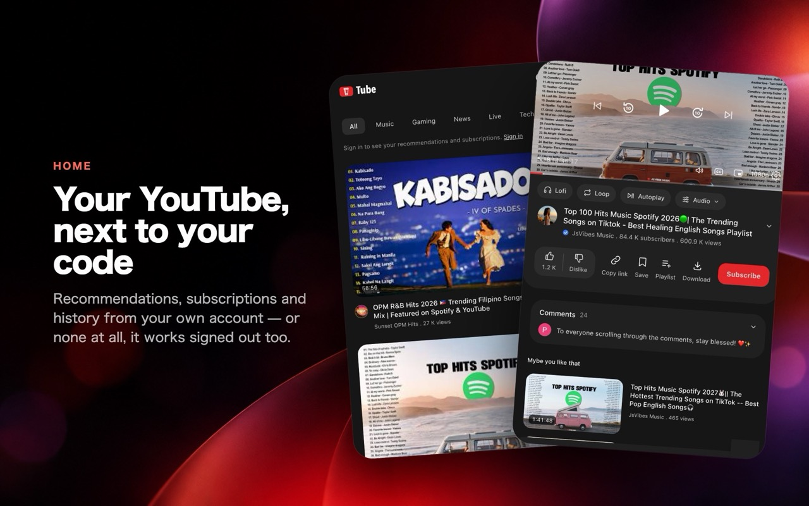
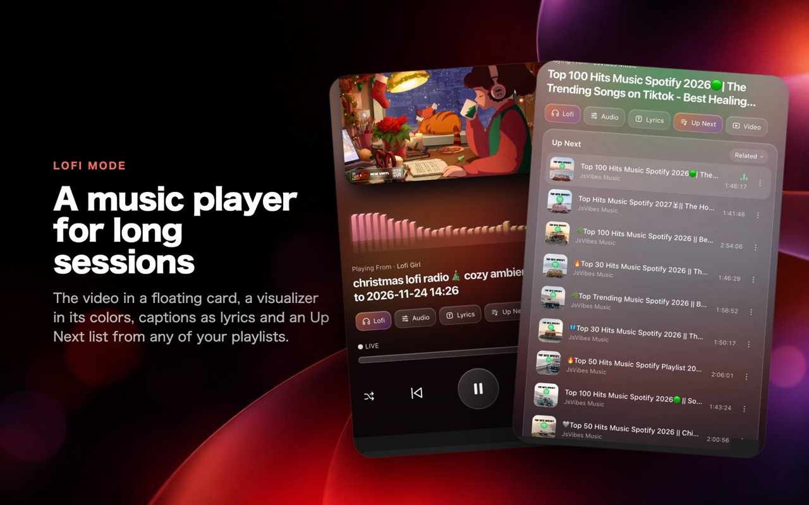
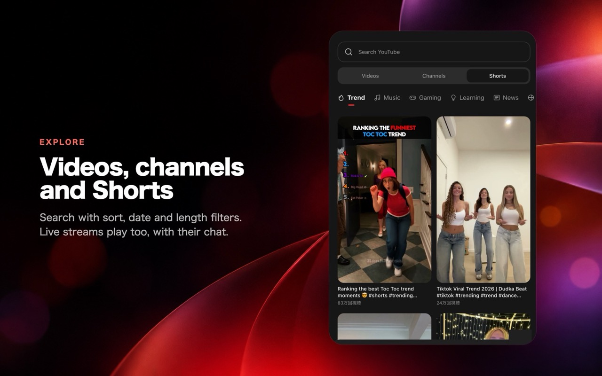
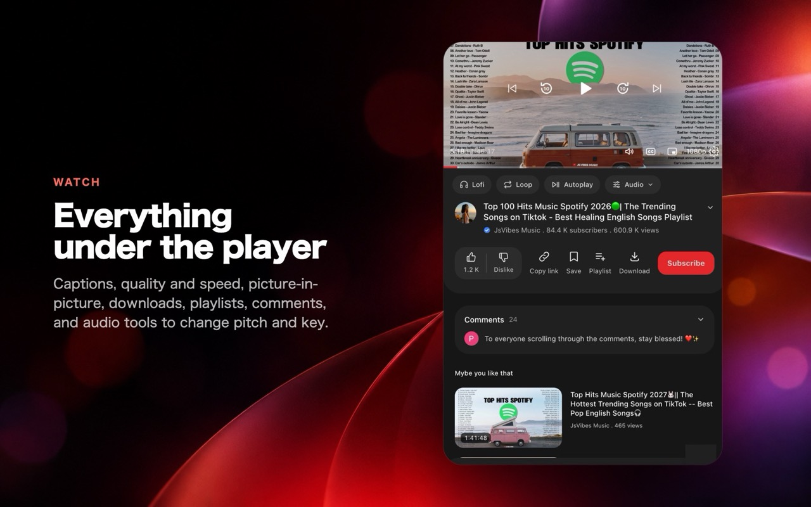
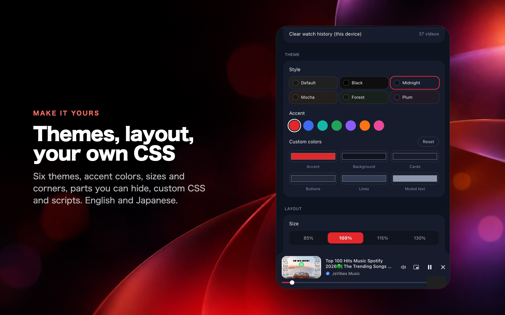

<div align="center">



# Tube

**YouTube in Orca's sidebar.**<br>
Watch, listen and browse without leaving your workspace.

[](https://github.com/net-runners-com/tube/tags)
[](https://orca.dev/plugins/net-runners-com/tube)
[](LICENSE)



</div>

---

## Why Tube

A tutorial, a talk or a playlist next to your code, without a browser tab to lose and without
leaving Orca. Tube is a full YouTube client in the right sidebar: its own interface, no embedded
youtube.com page, no ads in the feed.

## Features

### 🏠 Your YouTube, next to your code



- **Home** with your recommendations and subscriptions — or trending videos when signed out.
- **Channels** you follow, each channel's Videos, Shorts, Live and About.
- **Library**: history, your YouTube playlists, Watch later, liked and saved videos.
- **Sign in** with a browser profile you already use YouTube in. Optional: everything else works
  signed out.

### 🎧 Lofi mode — a music player for long sessions



- The video in a floating card over a background tinted from its thumbnail.
- A **3D visualizer** that moves with the music, in the video's own colors.
- **Lyrics**: the captions, line by line, under the video.
- **Up Next** from related videos or any of your playlists, with shuffle and repeat.

### 🔎 Videos, channels and Shorts



- Search videos, channels and Shorts; sort by relevance, popularity or date.
- Filter by upload date (last hour … this year) and length (under 3 min, 3–20, over 20).
- Categories: trending, music, gaming, learning, news, sports and more.

### ▶️ Everything under the player



- Quality up to 1080p, speed, **captions** (uploaded and automatic).
- **Live streams** with their **live chat**.
- Like, subscribe, **add to your playlists**, copy the link, **download** to `~/Downloads`.
- **Comments**, more from the channel, autoplay and loop.
- **Audio tools**: boost the volume, transpose by semitones, retune the reference pitch, change
  the speed without changing the pitch.
- A **mini player** that keeps playing while you browse.

### 🪟 Picture-in-picture

- Pop the video out into a **floating window** that stays on top of every app, and keep watching
  while you code in Orca or anywhere else.
- Tube's own controls in the window: play / pause, ±10 s, the seek bar — and captions stay on.
- Works from the player, the mini player and Lofi mode; one click brings the video back.

### 🎨 Make it yours



- Six themes, seven accent colors, or your own colors.
- Layout: size, corners, and the parts of the page you'd rather hide.
- **Custom CSS** and **custom scripts** for anything else.
- English and Japanese, following Orca's language.

## Install

In Orca: **Settings → Plugins**, find **Tube** in the community catalog and install it.

Or from a terminal:

```sh
orca plugin install net-runners-com/tube
```

### Requirements

- **macOS**
- **[yt-dlp](https://github.com/yt-dlp/yt-dlp)** with its extras, kept up to date — YouTube
  changes often:

  ```sh
  pipx install 'yt-dlp[default]'      # or: uv tool install 'yt-dlp[default]'
  ```

- **Node.js** or **Deno** on your PATH (yt-dlp uses it to read YouTube's player).

## Tips

- **Signing in**: open the account button (top right) and pick the browser profile you use
  YouTube in. macOS asks once for keychain access to read that browser's sign-in.
- **Playback stops with an error?** Update yt-dlp first; it fixes most problems.
- **Downloads** go to `~/Downloads` as MP4, at the quality set in Settings.
- **Offline**: Tube shows a notice and picks up again on its own when you're back online.

## Privacy

Tube talks to YouTube directly from your computer. Your sign-in stays on your machine, in Tube's
own storage; nothing is sent anywhere else.

## License

[MIT](LICENSE) © net-runners-com
